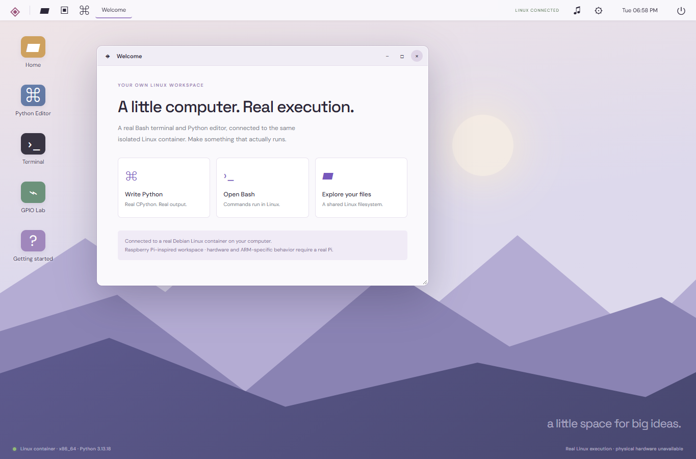
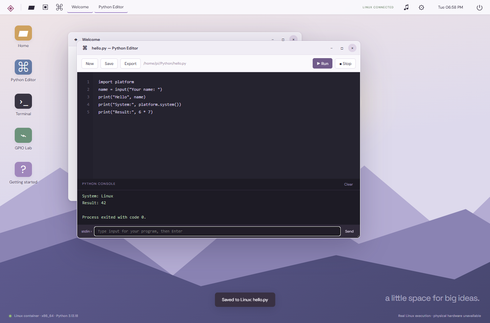
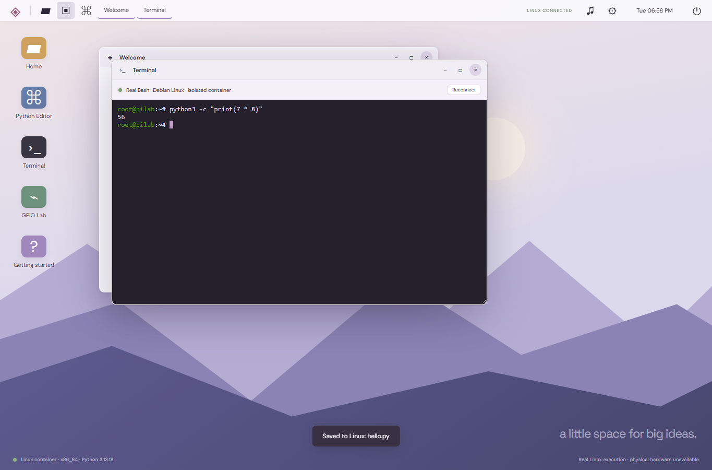
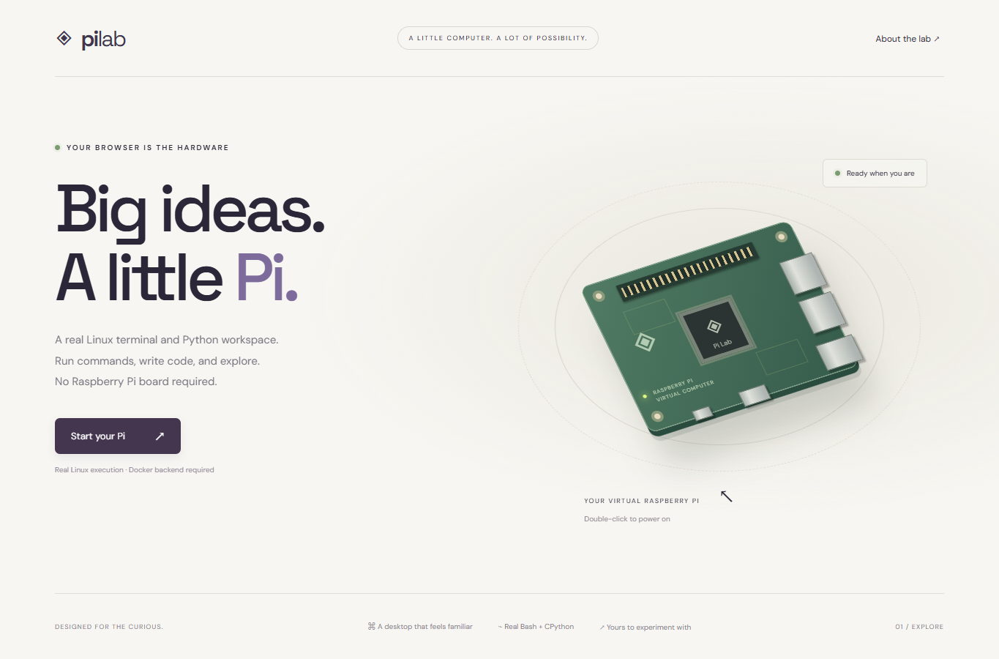

# ◈ Pi Lab — a little computer, real execution

> A Raspberry Pi-inspired Linux workspace in your browser. **Commands execute in a real Bash terminal. Python runs in real CPython.** Both use the same isolated Linux filesystem.

| Property      | Value                                                     |
| :------------ | :-------------------------------------------------------- |
| Status        | Local Linux workbench; GitHub source release              |
| Runtime       | Debian Bookworm container · CPython 3.13 · Bash PTY       |
| Interface     | HTML, CSS, JavaScript · xterm.js                          |
| Backend       | Python · aiohttp · WebSockets · Linux pseudo-terminals    |
| Local address | [localhost:4180](http://localhost:4180)                   |
| Hosting       | Not deployed; local use only                              |
| Hardware      | No Raspberry Pi board required; physical GPIO unavailable |
| Verified      | 17 November 2026                                          |

---

## 🖼️ Verified Visual UI Gallery

Real screenshots captured from the running application, including output from the Linux backend.

|                             Your workspace                             |                                            Real Python execution                                             |
| :--------------------------------------------------------------------: | :----------------------------------------------------------------------------------------------------------: |
|                   |  |
|                          **Interactive Bash**                          |                                             **Board launchpad**                                              |
|  |                          |

---

## 🚀 Run locally

Install Docker Desktop (Windows/macOS) or Docker Engine with Compose (Linux). On Windows, Docker Desktop must use Linux containers with WSL 2 enabled.

```bash
git clone https://github.com/KARTHIKEYASHARMA672/pi-lab.git
cd pi-lab
docker compose up --build -d
```

Open **[http://localhost:4180](http://localhost:4180)** and double-click the board or select **Start your Pi**. The panel shows **LINUX CONNECTED** when the backend is ready. The first image build downloads Debian tools and Python dependencies.

```bash
docker compose logs --tail 50   # Inspect the service
docker compose stop            # Stop, preserving saved files
docker compose start           # Resume
```

No Node installation is needed to run the app. The xterm.js browser assets are included under `dist/vendor/` with their licenses. npm dependencies and the lockfile are provided for updating those assets.

---

## 🛠️ What actually runs

| Feature       | Behavior                                                                                                             |
| :------------ | :------------------------------------------------------------------------------------------------------------------- |
| Terminal      | Real interactive Bash attached to a Linux PTY over WebSocket                                                         |
| Commands      | Actual `ls`, `cd`, pipes, redirection, shell scripts, `git`, `curl`, `nano`, `python3`, and installed Linux programs |
| Python Editor | Streams stdout/stderr from a CPython subprocess; supports `input()`, errors, exit codes, and Stop                    |
| Files         | Real text files under `/home/pi`, shared by Bash, the editor, and File Manager                                       |
| Packages      | `apt` and `pip` run inside the container; outbound internet access is needed                                         |
| Persistence   | `/home/pi` lives in the named `pi-home` Docker volume                                                                |
| Desktop       | Movable, resizable, maximizable, and minimizable windows; preferences and backup export/restore                      |
| Hardware      | No mock physical GPIO responses; Pi-specific hardware APIs require a real board                                      |

Try these in Terminal:

```bash
pwd
uname -m
python3 --version
printf 'one\ntwo\n' | wc -l
nano /home/pi/Python/experiment.py
python3 /home/pi/Python/experiment.py
```

The terminal runs as **root inside this personal container**. You can install packages with `apt update` and `apt install <package>`. Package changes survive a container restart but are lost when the image is rebuilt. Add permanent packages to `Dockerfile`. Keep project files in `/home/pi`; other container paths are not persisted.

In Python Editor, Run executes the current buffer without requiring Save. Save writes the buffer to Linux so the terminal can execute the same file. Use the console's stdin field for `input()`. Stop kills the Python process group. Editor runs have a ten-minute limit; closing a terminal disconnects its shell session.

File Manager refreshes from Linux every four seconds. Its view includes up to 1,000 non-hidden text files/folders, with a 2 MB per-file limit and an 8 MB snapshot budget. Use the terminal for binary files, hidden files, and larger projects. Workspace backups contain the files visible to File Manager; use external tools for full-volume backups.

---

## 🧭 What this environment is

> **This is real Debian Linux execution with a Raspberry Pi-inspired interface. It is not a booted Raspberry Pi OS image or an ARM emulator.**

The container uses the host's CPU architecture, verified here as `x86_64`. General Linux and Python development works without a physical Pi. ARM binaries, Raspberry Pi camera/GPIO interfaces, real sensor timing, USB peripherals, HATs, and desktop Linux GUI applications are not provided. Raspberry Pi names identify the inspiration; this project is independent and unaffiliated with Raspberry Pi Ltd.

The earlier browser-only Python runtime and simulated command dispatcher have been removed. There is **no simulated shell fallback**: if Linux is unavailable, the app displays a disconnected state.

---

## 🔒 Local execution boundary

This is a **single-user local development lab**, not a public code-execution platform. Compose binds port 4180 to `127.0.0.1`. The container has no host project mounts, Docker socket, privileged mode, or device mounts. Memory, CPU, and process limits are configured in Compose. File APIs stay inside `/home/pi`; requests require a local session cookie and reject cross-origin access and unexpected hostnames.

The terminal deliberately grants control of its container, including installing programs and changing files. Do not put host credentials into the container. Do not change the port binding to a public interface. A hosted, multi-user version needs authentication, authorization, a separate execution sandbox per user, quotas, and lifecycle management before public use.

---

## ✅ Verification

| Check                | Result                                                                                                                                                                         |
| :------------------- | :----------------------------------------------------------------------------------------------------------------------------------------------------------------------------- |
| Backend integration  | 12 checks passed: session boundary, origin checks, path confinement, real file writes, CPython/stdout/stdin/errors, Stop, shared files, Bash pipes, and full-screen nano       |
| Browser integration  | 11 checks passed: board boot, backend connection, real Python input/results, window controls, terminal rendering, saved file access, mobile layout, and no browser page errors |
| Package installation | Installed and executed `tree` inside the container                                                                                                                             |
| Syntax               | JavaScript syntax checks and Python compilation passed                                                                                                                         |
| Visual review        | Desktop, Python Editor, terminal, and mobile screenshots inspected                                                                                                             |

Backend checks (PowerShell):

```powershell
Get-Content tests/runtime_smoke.py -Raw | docker compose exec -T pi-lab python3 -
```

Backend checks (Bash):

```bash
docker compose exec -T pi-lab python3 - < tests/runtime_smoke.py
```

Browser checks use Playwright CLI against the running container. They create test files and update `hello.py` in the local lab volume:

```bash
npx @playwright/cli -s=piqa open http://127.0.0.1:4180
npx @playwright/cli -s=piqa run-code --filename=tests/browser-smoke.js
```

---

## 📁 Source map

| Path                          | Purpose                                                                  |
| :---------------------------- | :----------------------------------------------------------------------- |
| `backend/server.py`           | Local HTTP service, file APIs, Bash PTYs, and CPython processes          |
| `backend/requirements.txt`    | Tested, pinned Python dependencies                                       |
| `dist/app.js`                 | Desktop, windows, files, and editor UI                                   |
| `dist/backend-client.js`      | Real Linux connection, xterm, file synchronization, and Python transport |
| `compose.yaml` / `Dockerfile` | Isolated local Linux runtime and persistent home volume                  |
| `tests/`                      | Backend and browser integration checks                                   |

Design and verification consulted the existing `frontend-design`, `colours for websites`, and `visual_ui_testing` skills in the owner's skills repository. No new skills were imported or installed. 21st AI drafting was unavailable for this account; the interface was implemented directly.

---

## 📣 Publication status

> **GitHub source publication:** authorized by the owner.
> **Public hosting and social sharing:** awaiting separate owner approval. No social release is scheduled.

<!-- linkedin-automation: {"status": "unapproved", "published": false} -->
